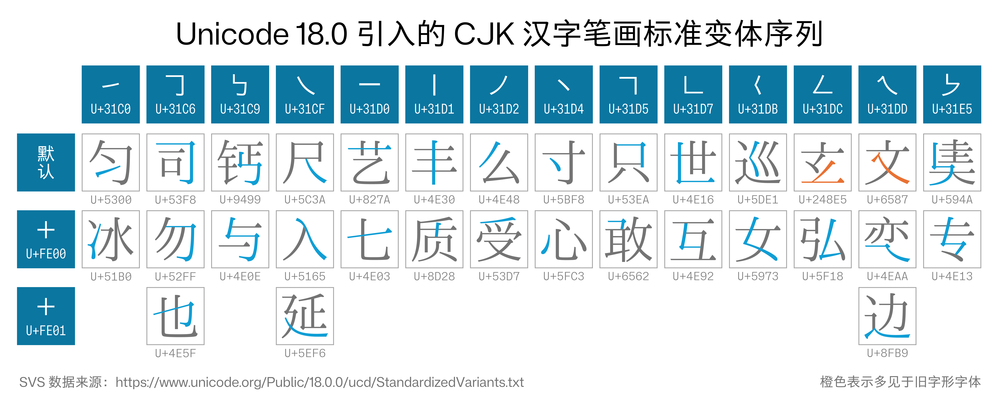

# 版本更新记录

## [v1.309] - 2026-11-10

- 新增汉字：𢓡
- 调整符号：▓
- 新增 CP437 符号：☺☻◘◙☼►◄▬↨⌐⌠⌡
- 根据 Unicode 18.0 的 G 源横扩，调整以下兼容汉字：益靖諸鶴禍

---

## [v1.308] - 2026-10-23

- 新增汉字：𡇌。

---

## [v1.307] - 2026-10-23

- 新增汉字：𭎜（铅～法）𨀁（～踵）。

---

## [v1.306] - 2026-10-22

- 新增汉字：𡵌𢵮𫄠𱷥𲋄。

---

## [v1.305] - 2026-08-20

- 新增汉字：𤒹𫛪。

---

## [v1.304] - 2026-07-14

- 新增汉字：𨨛𫋷𫓼；
- 调整汉字：步涉侷挶梮狍焗寴旜犫癐𥹉寷墖蘾蘹崥；
- 对「⊞`U+229E」新增 U+1F7FC 码位映射；
- 调整 logo 的位置和宽度。

---

## [v1.303] - 2026-06-19

- 新增 Unicode 18.0 将引入的货币符号：⃂`U+20C2`、⃃`U+20C3`、⃄`U+20C4`；
- 微调字形：暅；
- 新增汉字：𰹲𤟠𤟥𰛴𩿺𬸁𠹳𠆩𠆾𢒼𢓁𢓉𢓌𪛗𪛘𪛙𪛚𪛛𪛜𪛝𱝫𱝬𪻕。

---

## [v1.302] - 2026-05-26

- 新增 Unicode 18.0 引入的针对 CJK 汉字笔画的标准变体序列（SVS）：
  
- 新增寒武纪符号 Ꞓ`U+A792` 及其小写 ꞓ`U+A793`。
- 调整字形：霆拦栏烂㳕𰑐𰬊𰵟
- Plus 调整字形：㢜

---

## [v1.301] - 2026-05-04

- 调整「ɿ `U+027F`」的下伸长度；
- 新增以下组合字形：Ŋ̄ŋ̄Ŋ́ŋ́Ŋ̌ŋ̌Ŋ̀ŋ̀（即汉语拼音 ng 简写的四声标调）。
- 以下为上个版本的更新内容：
  - Plus 版重制扩展 A 区所有剩余字形；
  - 新增以下汉字：𫪩𫱖𧗩𠀾𠁞𲓖𤡯𡿒𳁩𥾺𧵈𨋌𩝎𫎓𮗻𮷍𲁰；
  - 新增即将于 Unicode 18.0 加入的下标 w、y、z（码位分别为 U+209D～U+209F），以及平假名 koto（U+1B123）、片假名 yori（U+1B126）；
  - 从 IPAexGothic 原有变体字形中借用：嘲愈槌瀦篝蛸註迄迦遜鵠，并调整了一些其他汉字字形。

---

## [v1.300] - 2026-05-03

- Plus 版重制扩展 A 区所有剩余字形；
- 新增以下汉字：𫪩𫱖𧗩𠀾𠁞𲓖𤡯𡿒𳁩𥾺𧵈𨋌𩝎𫎓𮗻𮷍𲁰；
- 新增即将于 Unicode 18.0 加入的下标 w、y、z（码位分别为 U+209D～U+209F），以及平假名 koto（U+1B123）、片假名 yori（U+1B126）；
- 从 IPAexGothic 原有变体字形中借用：嘲愈槌瀦篝蛸註迄迦遜鵠，并调整了一些其他汉字字形。

---

## [v1.242] - 2026-02-27

- 调整「赱」；
- Plus 微调「䖃」。

---

## [v1.241] - 2026-02-08

- 调整以下字形：嚉濧襨譵轛鑆。
- 将 `openTypeVheaVertTypoAscender` 和 `openTypeVheaVertTypoDescender` 值分别调整为 1024 和 -1024，以修复某些环境下竖排行距过宽的问题。lxgw/LxgwWenKai#182
- Plus 版重拼 500 字，扩 A 剩余 2500 字。
  

  
点此查看详情。

  㐡㐢㐤㐭㐺㐿㑅㑍㑎㑥㑷㑼㒆㒗㒧㓃㓢㓭㓼㔰㔲㔴㔵㔶㔷㔸㕂㕃㕄㕅㕆㕇㕈㕋㕍㕎㕒㕟㕡㕢㕧㕨㕭㕵㕼㕿㖀㖁㖄㖑㖗㖟㖥㖧㖫㖮㖷㖹㖼㗆㗋㗟㗡㘘㘠㘢㘤㘶㙁㙌㙠㙬㙰㙱㙸㚮㚹㛕㛘㛞㛡㛧㛨㛩㛳㛻㛾㜐㜑㜗㜘㜥㜩㜪㜰㜶㜸㜾㞒㞠㞤㞥㞮㞯㞼㟀㟍㟐㟑㟩㟻㟿㠝㠞㡕㡦㡨㡯㡰㡱㡲㡳㡴㢁㢈㢐㢖㢚㣅㣑㣞㣥㣪㤣㤳㤴㤹㤾㥆㥐㥒㥔㥗㥢㥥㦅㦕㦗㦝㦞㦟㦠㦡㦧㦩㦴㦶㧕㧵㨇㨎㨒㨔㨝㨞㨟㨦㫤㫲㫺㫻㬂㬃㭛㭲㮉㮋㮌㮖㮫㯀㯙㯝㯠㯢㯫㯲㯸㰄㰅㰋㰐㰖㰙㰚㰜㰢㰱㰻㰽㱁㱆㱉㱋㱥㱨㱰㱴㱸㴰㴵㵕㵗㵢㵧㶛㶯㶳㶵㶼㶿㷁㷒㷙㷣㷬㷱㷲㷶㷷㷸㷽㷾㸁㸃㸥㸶㸻㹀㹳㹶㹷㺅㺑㺓㺥㺱㺺㻂㻆㻌㻑㻒㻔㻕㻖㻗㻙㻠㻡㻣㻥㻦㻧㻨㻳㻵㻸㻹㼛㼭㼮㽯㽾㾆㾈㾋㾖㾝㾞㾣㾲㿍㿯㿱㿳䀔䀖䀘䀟䀭䀰䀵䀶䁋䁍䁔䁗䁜䁣䁮䁱䁹䂁䂏䂗䂙䂚䂦䂳䃀䃆䃏䃝䃡䃸䄑䄓䄰䄶䄿䅐䅒䅜䅾䆄䆎䇩䈊䈙䈚䈢䊃䊔䊗䊫䋂䋪䋭䋰䋳䌟䌩䌭䌳䍒䍱䍾䍿䎙䎡䎳䎽䎾䏁䑀䑳䑴䒅䖞䖺䖾䗀䗌䗞䗭䘋䘎䘧䘹䘺䘻䘿䙋䚋䚏䚒䚓䚔䛃䛍䛵䝩䞉䞙䞭䞱䟮䟻䠅䠇䠈䠑䠣䠮䠹䡆䡇䡈䡤䡦䡨䢨䢩䢮䤈䤉䤘䤤䥀䥅䥈䥊䥘䥴䦽䧋䧩䧫䧯䨃䨅䨈䨉䩖䩙䩣䪌䪬䪯䫟䫸䫹䫺䫼䫾䬀䬄䬅䬆䬇䬈䬉䬊䬋䬍䬐䬑䬓䬔䬖䬗䬘䬙䬚䬝䬞䬠䬤䬩䬵䭀䭁䭦䭸䮇䮚䮣䮨䮪䮬䯘䯡䯦䰢䱮䲬䲰䲲䲴䲽䳏䴟䴠䴢䴤䴦䴷䵠䵥䵳䵴䵵䵶䶆䶔䶘䶚䶛䶤
  

---

## [v1.240] - 2026-01-31

- 调整字形：氬氮氡氢氠崮伓濦籦镽沜沊园氪鴌郟
- 调整「之」部件：尐之乏姂徔抸柉椘泛疺眨砭窆芝覂貶贬鴔
  
- Plus 版重拼 2000+ 扩 A 汉字字形，目前还剩 3000 字未重拼。
  

  
点击查看详情

  
㐇㐈㐉㐊㐋㐍㐏㐐㐑㐒㐓㐔㐕㐗㐘㐛㐟㐨㐩㐰㐴㐵㐶㐸㐹㐻㐽㐾㑃㑈㑋㑕㑛㑟㑠㑦㑫㑮㑱㑻㒀㒄㒊㒍㒑㒖㒚㒢㒤㒥㒩㒭㒮㒯㒰㒱㒴㓀㓂㓄㓅㓆㓈㓉㓊㓋㓌㓍㓎㓑㓓㓔㓖㓗㓘㓜㓝㓞㓠㓣㓨㓪㓮㓱㓵㔁㔓㔗㔘㔙㔜㔞㔠㔼㕊㕐㕓㕖㕚㕛㕦㕫㕰㕲㕽㖃㖇㖌㖕㖙㖜㖣㖬㖲㖳㖺㖻㗃㗓㗗㗤㗥㗩㗪㗭㗷㗹㗻㘁㘃㘇㘈㘓㘙㘞㘟㘡㘣㘩㘪㘷㘻㘼㙂㙃㙄㙅㙇㙈㙋㙎㙔㙕㙖㙝㙢㙥㙨㙩㙪㙭㙮㙷㙻㚆㚈㚊㚋㚌㚍㚘㚡㚤㚥㚦㚧㚪㚭㚯㚱㚲㚸㚼㚾㛀㛁㛈㛒㛔㛖㛙㛛㛟㛠㛭㛰㛴㛷㛺㜃㜆㜓㜕㜖㜤㜧㜬㜯㜿㝂㝄㝇㝈㝍㝏㝕㝝㝷㝻㝽㞝㞨㞴㞶㟄㟆㟈㟊㟋㟌㟎㟘㟝㟭㟰㟱㟷㠁㠃㠉㠎㠜㠟㠤㠧㠳㠽㡈㡉㡊㡎㡗㡛㡝㡞㡠㡣㡤㡥㡩㡹㡺㡾㢆㢌㢓㢔㢟㢠㢡㢢㢣㢥㢦㢨㢩㢪㢰㢱㢳㢵㢷㢸㢹㢻㢽㣂㣃㣄㣆㣉㣌㣍㣏㣒㣔㣗㣘㣚㣟㣠㣢㣤㣦㣬㣰㣵㣷㤃㤆㤈㤓㤖㤨㤬㤯㤼㤽㥀㥂㥇㥉㥍㥓㥞㥪㥷㥸㥺㥾㦀㦃㦇㦉㦓㦖㦚㦥㦫㦭㦵㦷㦹㦺㦻㧄㧋㧍㧓㧝㧠㧢㧧㧫㧰㧶㨁㨅㨉㨍㨖㨠㨣㨯㨰㨳㨶㨷㨸㨺㩁㩃㩅㩏㩕㩛㩝㩞㩨㩼㩽㩾㪆㪈㪉㪌㪎㪑㪕㪘㪙㪜㪞㪣㪦㪨㪩㪫㪭㪹㪾㫅㫆㫋㫎㫓㫛㫞㫠㫨㬆㬱㬴㬸㬻㬾㭀㭁㭍㭏㭔㭗㭘㭙㭝㭡㭣㭤㭥㭧㭩㭾㮃㮧㮷㮸㯆㯉㯡㯥㯾㰩㰭㰰㱓㱩㱪㱱㱷㱼㱾㲆㲊㲋㲍㲣㲬㲳㲴㲵㲸㳅㳋㳍㳢㳣㴬㵅㵙㵷㵸㵽㶏㶡㶢㶮㶽㶾㷊㷌㷵㷼㸈㸗㸘㸙㸤㸫㸲㸹㹌㹍㹏㹒㹟㹣㹩㹯㹻㹼㹽㺁㺋㺖㺘㺚㺟㺨㺮㺰㺲㺴㺾㺿㻁㻅㻇㻍㻏㻘㻜㻝㻯㻱㻴㻻㻼㼀㼁㼄㼘㼙㼚㼦㼧㼨㼪㼯㼰㼱㼵㼷㼻㽄㽇㽈㽉㽋㽓㽥㽦㽧㽩㽭㽰㽻㾄㾒㾾㾿㿟㿣㿤㿥㿧㿹㿻㿿䀂䀄䀍䀏䀛䀝䀡䀣䀥䀧䀫䀬䀲䁏䁑䁒䁕䁛䁫䁼䂇䂊䂋䂌䂞䂢䂧䂱䂵䂺䂼䃃䃍䃒䃕䃛䃜䃤䃥䃨䃹䃺䃻䃼䃾䄌䄒䄖䄙䄚䄢䄣䄧䄩䄪䄫䄬䄱䅅䅇䅉䅌䅑䅔䅗䅚䅞䅠䅧䅪䅵䅶䅿䆊䆑䆙䇃䇄䇅䇈䇉䇍䇑䇔䇕䇜䇞䇡䇢䇫䇬䈣䉻䉼䉿䊎䊑䊖䊙䊢䊧䊩䊮䊶䊸䊻䊾䋄䋇䋈䋌䋏䋓䋗䋙䋜䋨䋬䋹䋻䌁䌆䌋䌍䌏䌔䌖䌜䌢䌣䌦䌨䌸䌺䌼䌾䌿䍀䍄䍛䍠䍢䍣䍤䍥䍦䍩䍯䍳䍴䍷䍸䍹䍺䎅䎊䎌䎏䎐䎒䎔䎕䎗䎘䎝䎟䎠䎤䎩䎸䏃䏉䏑䏔䏟䏣䏤䏩䏪䏵䏶䏸䏹䏺䏻䏽䐄䐉䐊䐎䐏䐕䐘䐞䐡䐬䐮䐱䐹䐺䐼䐽䐾䑃䑊䑑䑒䑝䑠䑡䑢䑣䑤䑥䑪䒃䒓䓓䓢䓻䖎䖐䖚䖜䖨䗉䗚䗢䗦䗯䗱䗶䗷䗾䘃䘓䘔䘛䘝䘞䘟䘢䘤䘩䘫䘸䙂䙍䙏䙐䙗䙛䙞䙫䙳䙵䚗䚜䚹䚺䚼䛀䛆䛑䛔䛗䛝䛤䛧䛨䛰䛿䜀䜊䜍䜔䜙䜚䜞䜡䜢䜤䜥䜦䜧䜨䜬䜰䜴䜷䜸䜹䜻䝅䝌䝑䝒䝓䝗䝘䝡䝢䝱䝳䞀䞃䞄䞌䞎䞐䞕䞟䞥䞧䞬䞮䞲䞴䞺䞾䟈䟊䟌䟍䟐䟑䟕䟗䟝䟢䟤䟬䟭䟳䟹䟾䠋䠔䠨䠫䠯䠺䡒䡚䡟䡰䡲䡴䢋䢌䢎䢏䢐䢔䢖䢗䢛䢞䢟䢫䢰䢴䢶䢷䣃䣄䣇䣉䣒䣖䣛䣦䣩䣫䣬䣮䣱䣶䤄䤑䤔䤚䤣䤯䤳䥦䥪䥳䥹䥻䥼䥾䥿䦀䦁䦄䦌䦵䦸䦻䦿䧀䧁䧃䧅䧌䧎䧔䧖䧗䧝䧤䧨䧮䧱䧲䧳䧴䧶䧷䧸䧹䧻䧽䧾䧿䨀䨋䨌䨏䨐䨓䨜䨣䨭䨱䨾䩐䩑䩔䩜䩞䩧䩨䩼䩽䪁䪅䪆䪈䪉䪋䪑䪒䪓䪔䪗䪘䪙䪨䪫䪽䫀䫂䫃䫄䫉䫋䫎䫑䫕䫘䫚䫝䫡䫢䫣䫫䫽䫿䬁䬂䬎䬛䬜䬦䬪䬬䬯䬱䬴䬺䬼䬽䭂䭃䭅䭊䭚䭜䭝䭥䭪䭯䭿䮀䮃䮆䮉䮒䮕䮞䮡䮦䮫䮮䮱䮴䮵䮶䮷䯃䯇䯈䯉䯌䯍䯎䯏䯑䯙䯚䯠䯤䯥䯫䯭䯮䯶䯸䯻䰃䰘䰚䰞䰡䰤䰪䰷䰸䰹䱁䱂䱃䱉䱝䱦䱭䱴䱾䲔䲦䲭䲱䲼䳁䳈䳋䳌䳓䳕䳬䳼䴀䴧䴫䴬䴭䴮䴰䴱䴲䴴䵇䵊䵍䵎䵔䵧䵺䵿䶀䶂䶅䶎䶓䶞䶟䶫䶬䶯䶰䶳㐖㐙㐜㐠㐣㐳㐼㑄㑤㑧㑭㑵㑶㑹㑽㒋㒏㒔㒕㒛㒠㓙㓸㔃㔎㔚㔛㕉㕌㕻㖂㖆㖏㖐㖓㖘㖪㖽㗌㗜㗢㗣㗧㗫㗬㗯㗶㘂㘐㘨㘬㘮㘸㘹㘺㘿㙆㙉㙑㙒㙗㙚㙛㙜㙧㙲㙳㙴㙹㙺㙼㙽㙿㚀㚂㚃㚄㚎㚏㚔㚕㚚㚟㚨㚩㚴㚶㚿㛂㛆㛇㛉㛍㛎㛐㛓㛗㛜㛝㛣㛦㛯㛲㛿㜂㜈㜎㜚㜜㜞㜟㜠㜡㜢㜣㜫㜲㜻㜽㝆㝊㝎㝒㝓㝔㝖㝘㝚㝧㝪㝯㝸㞂㞆㞋㞌㞏㞐㞑㞔㞦㞪㞫㞬㞰㞱㞲㞹㞽㞾㟇㟉㟓㟙㟠㟪㟮㟲㠂㠚㠮㠰㠲㠴㠺㠿㡄㡏㡔㡫㢃㢊㢋㢕㢭㢯㢼㢿㣫㣱㣲㣶㣻㣼㣽㣾㣿㤄㤌㤍㤎㤐㤑㤔㤛㤜㤟㤤㤧㤪㤱㥎㥛㥩㥬㥭㥱㥳㥴㥶㥻㥽㦄㦊㦋㦌㦏㦑㦢㦤㦨㦪㦬㦯㦾㦿㧂㧃㧆㧇㧈㧉㧊㧘㧙㧚㧛㧜㧞㧦㧩㧪㧮㧲㧴㧼㧽㧿㨆㨈㨊㨋㨌㨏㨐㨕㨙㨚㨛㨡㨤㨵㨹㩂㩚㩺㩿㪁㪂㪃㪇㪊㪏㪓㪔㪖㪛㪝㪠㪡㪢㪥㪧㪬㪮㪯㪴㪵㪶㪻㪼㫂㫉㫏㫐㫒㫔㫕㫘㫙㫜㫢㫥㫦㫩㫫㫬㫮㫯㫵㫶㫸㬄㬈㬌㬍㬐㬑㬣㬥㬧㬨㬩㬯㬳㬶㬼㬽㭂㭃㭄㭅㭈㭊㭖㭦㭪㭫㭬㭵㭸㭽㮊㮓㮕㮘㮡㮨㮹㮻㯋㯎㯕㯗㯩㯪㯷㯹㯺㯽㯿㰇㰎㰔㰞㰟㰤㰪㰮㰾㰿㱀㱅㱌㱑㱒㱕㱖㱗㱘㱠㱢㱬㱻㲂㲎㲒㲕㲖㲗㲘㲚㲛㲜㲞㲠㲦㲯㲶㲷㲼㲽㲿㳉㳓㳖㳪㳻㴀㴎㴓㴚㴜㴶㴻㵀㵍㵔㵖㵛㵱㶤㶧㶰㶴㶸㷇㷉㷖㷨㷭㸂㸄㸍㸓㸧㸨㸩㸯㸵㸷㸸㸺㹃㹄㹆㹈㹉㹙㹜㹝㹞㹤㹥㹪㹫㹱㹵㹹㹿㺆㺈㺌㺍㺏㺙㺤㺩㺪㺫㺯㻀㻃㻈㻊㻛㻟㻢㻤㻮㻰㻲㻶㻺㻾㻿㼃㼅㼇㼊㼋㼌㼍㼏㼐㼑㼔㼕㼗㼟㼡㼢㼣㼤㼩㼫㼬㼴㼶㼸㼼㼽㼾㼿㽀㽂㽃㽅㽆㽍㽟㽡㽣㽤㽫㽬㽮㾨㿂㿈㿝㿰㿲㿾䀃䀑䀨䀱䀷䁁䁠䁢䁤䁧䁨䁴䁶䁽䂆䂒䂟䂤䂥䂩䂬䂭䂯䂶䃄䃖䃞䃦䃪䃯䃱䃳䃴䃷䃽䄀䄁䄂䄄䄆䄇䄈䄊䄎䄕䄛䄞䄟䄠䄥䄲䄸䅁䅃䅆䅋䅫䅰䅹䅼䆋䆌䆒䆖䆟䇆䇇䇊䇋䇌䇎䇏䇐䇒䇖䇛䇝䇤䇥䇯䇱䇴䇷䇹䇺䇼䇾䈀䈁䈂䈃䈈䈉䈌䈏䈑䈒䈓䈔䈕䈖䈜䈝䈟䈠䈡䈤䈧䈩䈫䈬䈮䈯䈳䈴䈵䈺䈻䈾䉃䉅䉆䉇䉈䉉䉍䉏䉐䉑䉒䉔䉕䉙䉚䉛䉜䉠䉧䉩䉪䉫䉮䉳䊅䊉䊊䊏䊚䊛䊞䊟䊡䊥䊦䊨䊭䊰䊱䊵䊿䋋䋍䋐䋞䋠䋤䋵䋶䋿䌧䍂䍅䍆䍇䍈䍊䍋䍌䍍䍬䍰䎁䎆䎇䎍䎑䎧䎭䎮䎯䎲䏄䏅䏐䏒䏦䏯䏱䏳䐀䐓䑉䑌䑎䑩䒔䒥䒦䒬䒮䒯䒶䓁䓌䓱䔟䔨䔬䕁䕄䕥䕫䖃䖣䖪䖯䖲䖶䖷䗊䗜䗟䗣䗲䗳䗺䘂䘄䘅䘍䘐䘒䘖䘗䘘䘙䘠䘡䘦䘨䘷䙀䙃䙇䙈䙊䙎䙒䙔䙜䙝䙟䙠䙩䙲䙸䚣䚨䚬䚰䚲䚳䛉䛌䛏䛓䛟䛣䛥䛪䛴䜐䜟䜪䜫䜮䜯䜱䜲䜵䜶䜼䜽䜾䜿䝀䝁䝃䝄䝇䝊䝍䝎䝏䝐䝕䝚䝛䝝䝫䝬䝲䝴䝵䝷䞑䞘䞿䟟䟠䟣䟨䟪䟯䟶䟷䠗䠢䠻䠼䡃䡍䡏䡐䡙䡛䡣䡧䡫䡬䡹䡺䡼䡿䢃䢊䢙䢝䣈䣊䣥䣸䣹䣽䤃䤅䤎䤥䤦䥆䥐䥒䥢䥩䦧䦹䦺䦼䧏䧢䧥䧭䨂䨍䨔䨘䨠䨼䨽䨿䩀䩁䩂䩃䩅䩆䩇䩈䩉䩊䩋䩌䩍䩎䩒䩝䩟䩢䩩䩱䩵䪖䪞䪦䪩䪭䪱䪵䪷䫆䫖䫩䫪䫰䫻䬌䬏䬷䭛䭡䭱䭷䮅䮈䮊䮌䮔䮙䮝䮰䮲䯲䱄䱒䱕䱜䱠䱳䲈䲊䲍䲓䲫䲮䲺䳀䳉䳠䳨䳸䴨䴶䴹䴺䴼䴽䵀䵃䵄䶃䶌䶐䶒䶖䶝䶨

  

---

## [v1.239] - 2026-01-14

- 随下一版本「霞鹜文楷」新增扩 A 字：䛊；
- 「新晰黑＋」重拼以下汉字：㑝㓏㓚㕤㗝㘖㙐㛋㛌㛪㛶㜄㜅㜋㞭㞳㟞㡶㣛㪄㬗㭋㯚㯞㱽㲾㳀㳏㳑㳵㶨㶪䂜䂨䂷䂸䂿䄮䉾䊍䊼䋟䌇䏧䏼䗃䟔䣣䣧䤛䧇䪀䬢䬧䬹。

---

## [v1.238] - 2026-01-09

- 随「霞鹜晰黑」新增汉字：𥁫𥕦；
- 删除 `morx`、`feat`、`bsln` 等多余的表，以免影响 OpenType 特性的充分发挥。

---

## [v1.237] - 2026-01-02

- Plus 重拼以下汉字：㕔㦽㵞㶑䮧；
- 调整或修改以下字符：㈣㈥㈧㈳㈷㈼㈾㉃㊃㊅㊇㊓㊗㊛㊞㊢㊩㊪㊬㊮㊰㋿㍾㍿。

---

## [v1.236] - 2025-12-30

- 新增汉字（共 128 字）：𠎷𠖄𠗻𠞩𠠃𠠝𠯗𠲿𠳔𠼻𠽾𡂫𡝭𡢃𡳞𡷑𡼏𢆡𢎙𢔛𢝵𢫦𢯭𢯾𢱤𢲴𢲸𢳆𢳪𢼌𢼛𣁳𣛮𣮈𣲩𣻸𣼎𤃒𤉙𤊶𤌍𤍒𤍤𤐙𤐰𤞚𤨒𤲍𤶀𤶃𤸁𤸱𤺅𤺪𥌚𥐵𥑮𥟇𥯟𥯥𥺆𦉎𦊓𦜆𦟪𦤎𦸅𧉟𧌄𧍱𧒆𧥺𧦠𧩣𧬪𧮙𧻴𧿳𨂽𨂾𨅔𨋍𨍽𨎊𨒇𨢑𨸹𩑾𩛩𩜄𩜰𩵱𩶯𩸙𩸶𩺬𩼧𩼰𩽈𩽰𪁎𪂺𪇡𪐞𪖐𪘒𪙊𪹚𫒢𫝏𫝘𫝛𫝻𫞼𫟂𫟧𫠛𫣆𫬷𬠖𬦰𭉝𰇛𰣻𰹬𱇒𱇫𱱿。
- 调整字形：䴓嗯嗲廳摁煾琎甏聽。
- 调整「﹊」「﹎」。

---

## [v1.235] - 2025-12-14

- 微调「鄺」；
- 「新晰黑＋」重拼以下扩 A 字：㑂㑆㑔㑯㓐㓕㓳㔣㔧㔭㔹㕩㕹㕺㖒㖤㘦㘧㙏㙞㙣㙤㙫㚫㚳㛊㛫㛱㜏㝶㝺㝾㞃㞄㞅㞇㞈㞉㠊㠏㠫㠸㡽㢄㢏㢫㢮㣙㤊㤝㤢㥃㥌㥜㥧㦆㦛㧤㧨㧹㩻㪤㪸㫄㫑㫧㫾㫿㬋㬒㬝㭶㮀㮅㮢㮬㯏㯖㯦㰝㰣㰧㰫㰯㰴㰸㱂㱄㱶㲁㲇㲏㲡㲢㲭㲰㲻㳊㳔㳥㳦㳸㴆㴽㴾㵰㶬㶱㸊㸚㸞㸣㸱㸼㹁㹚㹸㺐㺞㺬㺳㺵㺷㺹㺽㻓㻩㻭㻷㽖㿞䀎䀒䀕䀗䀞䀠䀻䁬䁳䁵䁺䁻䂈䂕䂘䂛䂝䂠䂡䂾䃈䃋䃑䃢䄦䄳䅄䅕䅡䆪䇣䉺䊇䊽䋥䋴䌵䌶䍎䍻䍼䎢䎪䏬䐂䐙䑈䑦䑨䑭䓎䔆䔋䖊䖔䖡䘜䘳䚉䛜䛠䛱䝖䝜䞏䞵䟺䠃䠲䠴䠾䡋䡓䡘䡱䢭䢱䢲䢾䣁䣆䤬䦨䦩䦪䦭䦮䦱䦲䦴䧆䧒䧕䧵䨕䨟䩡䩫䪝䭕䭭䭰䮁䮋䮍䮐䮑䰙䰜䰝䱅䱈䱑䲚䲧䲨䲪䵗䵞䶈䶉；
- 新增针对破折号的 `ccmp` 特性；
- 新增针对标点挤压的 `chws` 和 `vchw` 特性〔注意：在 Chromium 内核的浏览器中，可能会因 `chws`（`vchw`）与 `halt`（`vhal`）冲突而出现标点过度挤压现象〕。

---

## [v1.234] - 2025-12-10

- 调整「趸」「虿」。

---

## [v1.233] - 2025-12-03

- 「新晰黑＋」修复「䝉 `U+4749`」误做成「𫎇 `U+2B387`」的问题。
- 「新晰黑」仅版本号改变，无实质性内容变化。

---

## [v1.232] - 2025-12-03

- 调整「宔」「箓」「菉」「㟤」；
- 微调「褦」轮廓；
- 「新晰黑＋」重拼以下字形：㐀㐞㒪㒫㒬㒶㒷㒻㒽㒾㒿㓒㔔㔖㔫㔬㔮㔽㔿㕀㕕㕗㕙㕯㕾㖋㖍㖎㖖㖚㖛㖝㖯㖰㗊㗠㗮㘏㘒㘜㘴㙯㚅㚉㚒㚓㚗㚛㚜㚝㚞㚠㝳㝴㞊㞣㞷㟗㠩㠪㠬㠭㠱㠻㡍㡬㡭㡮㢤㢧㢲㢴㣇㣈㣎㥖㥲㦰㦱㦲㪅㪲㪳㪽㫇㫈㫣㫱㫷㬲㭆㭟㮂㮚㮺㯄㯟㯬㯻㰈㱏㱐㳟㴇㶜㶠㷑㷠㷢㸑㸒㸔㸕㸦㻎㼂㼉㼒㼖㼜㽕䀆䀚䁀䁞䄐䄹䆃䆐䇂䊲䋣䍏䎜䎞䏋䏌䑕䑖䑞䑟䓥䖁䙪䙶䙽䚻䜭䜳䝂䝆䝉䟅䟫䡞䢄䢅䢆䢇䢉䢽䤗䨇䨊䩏䪢䪣䪥䬕䬟䬡䭆䭬䰯䲜䳃䴡䵈䵖䵻䵼䵽䶏䶱䶲䶴。

---

## [v1.231] - 2025-11-29

- 新增汉字：𠇮𠌂𠕂𠕅𠖇𠞭𠞰𠩄𠪱𠭯𠮾𠴟𠷿𠻳𠼟𡚁𡨘𡨥𡬶𡻕𢌚𢥞𢫓𢬸𢮥𢳟𢶀𢷬𢾖𣔙𣙜𣟄𣟴𣺌𤋮𤍐𤏶𤛘𤨏𤭛𤰜𤱈𤳈𤴡𤵐𤺥𥎊𥑪𥛱𥤚𥦗𥱼𥲻𦂳𦃂𦉆𦊑𦍑𦍩𦐌𦕈𦵏𧰵𨂿𨄮𨉣𨽻𩓐𩗗𪎭𫠦𫩴𬏟𭁵𭁹𮃄兔。

---

## [v1.230] - 2025-11-27

- 微调「偨」的轮廓；
- 补齐《霞鹜文楷 Lite》（v1.521）包含的全部扩 A 汉字：  
  㐃㐄㐅㐌㐧㐫㐱㐲㑀㑁㑒㑖㑗㑚㑣㑬㑲㑺㒇㒈㒣㒲㒳㒸㒹㒺㔂㔐㔕㔢㔻㕁㕑㕘㕠㕥㕱㕶㕸㖅㖵㖸㗁㗄㗘㗱㘆㘔㘛㘝㘯㘱㙓㚁㚇㚐㚣㚰㚵㚷㚽㜮㝀㝃㝑㝗㝛㝠㝩㞓㞢㠄㠙㡌㡑㡓㢘㣕㣖㣡㣣㣧㣨㣩㣮㣳㣴㣸㣹㤉㤕㤙㥁㥣㥦㥫㥰㥵㦸㧁㧅㧌㧎㧣㧱㧻㨂㨑㨨㨪㨫㨻㨿㩆㩌㩐㩙㩜㩦㩵㪍㪐㪚㪟㪷㫃㫝㫳㬉㬟㬪㬰㬷㬿㭉㭜㭠㮝㯭㯱㯳㰍㰵㱃㱿㲪㲹㳂㳄㳌㳞㳭㳲㳺㳽㴌㴘㴙㴢㴣㴱㴺㵈㵉㵎㵘㵜㵥㶂㶃㶆㶋㶐㶙㶝㶥㶦㶶㷟㷮㸐㸰㺊㻚㻞㻫㼓㼝㽁㽎㽒㽔㽞㾀㾊㾗㾱㾵㾹㿚㿜㿢㿸䀐䀯䁓䁯䂖䂫䃉䃗䃘䃠䃿䄃䄉䄍䆁䆉䇓䇶䈄䈰䉂䉡䉵䊀䊆䊓䊪䊷䊹䋚䋛䋲䌻䌽䍐䍑䍧䏍䏠䐌䐥䑲䒟䒣䒩䓃䓤䔕䔛䔲䕈䕭䕯䕺䖏䖙䖰䗆䗐䗫䗬䘌䘑䘚䘥䘮䙓䚀䚎䚮䛐䛡䜇䝔䝟䝨䞁䞓䞚䟓䟘䟦䟧䟩䠀䠊䠕䠡䠱䠶䠷䡭䡾䢀䢁䢍䢢䣺䤨䥥䧡䨞䨦䨬䨺䨻䪍䫈䬃䬸䭾䯀䯅䯧䰄䰇䰖䰛䰟䰻䰽䱋䱤䲞䲤䳇䳗䳘䳲䴵䴸䵑䵒䵤䶊䶧䶭；
- 补齐原始授权字体「IPAexゴシック」包含的全部扩 B 汉字并修改为 G 形或假想 G 形：  
  𠀋𠂢𠂤𠆢𠈓𠌫𠍱𠎁𠏹𠑊𠗖𠝏𠠇𠠺𠢹𠥼𠫓𠬝𠵅𠷡𠹤𠹭𠺕𠽟𡈁𡈽𡉕𡉴𡉻𡋗𡋤𡋽𡌛𡍄𡏄𡑭𡑮𡙇𡚴𡜆𡝂𡢽𡧃𡱖𡴭𡵅𡵢𡵸𡶒𡶜𡶡𡶷𡷠𡸳𡸴𡼞𡽶𡿺𢅻𢈘𢌞𢎭𢛳𢡛𢢫𢪸𢭆𢭏𢭐𢮦𢰝𢰤𢷡𣆶𣇃𣇄𣇵𣍲𣏐𣏒𣏓𣏕𣏚𣏟𣏤𣑊𣑋𣑑𣑥𣓤𣕚𣖔𣗄𣘸𣘹𣘺𣙇𣜌𣜜𣜿𣝣𣝤𣟧𣟿𣠤𣠽𣪘𣱿𣳾𣴀𣴎𣵀𣷓𣷹𣷺𣽾𤂖𤄃𤇆𤎼𤘩𤚥𤟱𤢖𤩍𤭖𤭯𤰖𤸎𤸷𤹪𤺋𥁊𥁕𥄢𥆩𥇍𥇥𥈞𥉌𥐮𥒎𥓙𥔎𥖧𥝱𥞩𥞴𥧄𥧔𥫣𥫤𥫱𥮲𥱋𥱤𥶡𥸮𥹖𥹢𥹥𥻂𥻘𥻨𥼣𥽜𥿔𥿠𥿻𦀌𦀗𦁠𦃭𦊆𦐂𦙾𦚰𦜝𦣝𦣪𦧝𦨞𦩘𦪌𦪷𦫿𦰩𦱳𦳝𦹀𦹥𦾔𦿶𦿷𦿸𧃴𧄍𧄹𧏚𧏛𧐐𧑉𧘔𧘕𧘱𧚄𧚓𧜎𧜣𧝒𧦅𧪄𧮳𧮾𧯇𧲸𧶠𧸐𨂊𨂻𨉷𨊂𨋳𨏍𨐌𨑕𨕫𨗈𨗉𨛗𨛺𨥆𨥉𨥫𨦇𨦈𨦺𨦻𨨞𨨩𨩃𨩱𨪙𨫍𨫝𨫤𨯁𨯯𨴐𨵱𨷻𨸟𨸶𨺉𨻫𨼲𨿸𩊠𩊱𩒐𩗏𩛰𩜙𩝐𩣆𩩲𩷛𩸕𩸽𩹉𩺊𩻄𩻛𩻩𩿎𪀚𪀯𪂂𪃹𪆐𪎌𪐷𪗱𪘂𪘚𪚲；
- 新增其他汉字：𠐭𣴘𦳯㣣。

---

## [v1.228] - 2025-11-22

- 新增汉字：㛤𪢼𫆏𫈟𫏋𫓴𫩫𬙇𬮥𬶁𬸊𬸢𮷌𰛦𰮇𰱟𱇳𱇶；
- 调整汉字：刈。

---

## [v1.227] - 2025-11-07

- 新增 ꟱`U+A7F1`；
- 微调 ꟲꟳꟴ𐞥；
- 新增汉字：䏓䕡䱀䳭𠬤𦥯𩷶𫁡𫇦𫚐𫚪𮬛𰀡𰀢𰁜𰃮𰡉𰡓𰯲𰱓𰱩𱇝𱇮𱇾𱉍𱉐𱉻𱉼𱊊𱊬𲇴𲇽𳎘。

---

## [v1.226] - 2025-10-28

- 调整数学运算符：≌≤≥≮≯，并将原有的全宽符号设为 `fwid` 特性调用；
- 调整「裤」的轮廓细节；
- 新增汉字：𢶍𧰎𩷓𩷕𩹎𪄳𬉧𬵨𱆥𲎿。

---

## [v1.225] - 2025-10-22

- 调整「场」「殇」的笔画细节。

---

## [v1.224] - 2025-10-07

- 根据 Unicode 17.0 中 G 源字形调整，修改「鿄」右上部「刃」为 G 形。

---

## [v1.223] - 2025-09-22

- 对以下字形设置多重映射：
  - 彐 `U+5F50`, `U+2B739`
  - 〈 `U+3008`, `U+2329`
  - 〉 `U+3009`, `U+232A`

---

## [v1.222.1] - 2025-09-21

- 对以下字形设置多重映射：彐 `U+5F50`, `U+2B739`

---

## [v1.222] - 2025-09-20

- 根据 Unicode 17.0 中 G 源字形调整，修改「匩」中部为上下连通。
- 新增「𣽽`U+23F7D`」，字形作「⿰氵⿱𣏟⺝」，与「潸`U+6F78`」的「⿰氵⿱林⺝」字形作区分；移除「潸`U+6F78`」字形的 U+23F7D 映射。
- 调整「�`U+FFFD`」的细节。

---

## [v1.221] - 2025-09-19

- 根据 Unicode 17.0 中 G 源字形的调整，修改「欥」左部为「曰」。

---

## [v1.220] - 2025-09-08

- 对以下字形设置多重映射：
  - 䏙 `U+43D9`, `U+4DBB`
  - 䐋 `U+440B`, `U+4DBC`
  - 兀 `U+5140`, `U+FA0C`
  - 凉 `U+51C9`, `U+F979`
  - 嗀 `U+55C0`, `U+FA0D`
  - 幐 `U+5E50`, `U+3B3A`
  - 朡 `U+6721`, `U+4DBD`
  - 槩 `U+69E9`, `U+3BA3`
  - 秊 `U+79CA`, `U+F995`
  - 胶 `U+80F6`, `U+3B35`
  - 裏 `U+88CF`, `U+F9E7`
  - 郞 `U+90DE`, `U+F92C`
  - 隣 `U+96A3`, `U+F9F1`
- 新增特殊符号：`U+FFFC`、�`U+FFFD`。

---

## [v1.219] - 2025-09-05

- 新增将于 Unicode 17.0 加入的扩 C+、扩 E+、扩 J 汉字：𫜺𫜻𬺭𲘥𲘿𲝻𲠀𲠍𲨔𲰹𲰼𲶹𲷇𲸰𲾝𳄮𳇫𳋩𳋭𳋮𳋳。可复制上述汉字在[叶典](https://www.yedict.com)查询。
- 根据 GB 18030-2022，调整以下康熙部首：⼾⽏⽰⽱⽾⿇⿋⿍。
- 根据 GB 18030-2022，「肭`U+80AD`」「䶺`U+4DBA`」通过「内/內」区分。
- 根据 Unicode 17.0 中 G 源字形调整，调整「曶`U+66F6`」从曰、「㫚`U+3ADA`」从日。
- 新增 Unicode 17.0 加入的沙特新里亚尔货币符号「⃁`U+20C1`」。

---

## [v1.218.1] - 2025-07-13

- 新增符号「␥`U+2425`」「␦`U+2426`」；
- 调整汉字「僰」。
- 「新晰黑＋」调整汉字「䣋」「䖙」。

---

## [v1.218] - 2025-06-17

- 调整「無」部件为下横长。涉及以下汉字：無嘸墲嫵幠廡憮撫橅潕璑甒瞴膴蕪蟱譕鄦鷡㷻舞儛躌㵲橆㒇㣳㶃䉑䌗䍢䒉。

---

## [v1.217.1] - 2025-06-09

- 修正「鿮」错形。

---

## [v1.217] - 2025-05-29

- 新增西里尔文：ӉӞӟӤӥӪӫӰӱӲӳӴӵӾӿ
- 新增符号：㉄㉅㉆㉇㉈㉉㉊㉋㉌㉍㉎㉏⋰⋱⋅⌀ₔ➡⬅⬆⬇⌂⌥⌦⌫⎇⎋℮₻₼₾₿⃀℁℆⅍℗℞⟨⟩⟪⟫⹕⹖⹀⸮☏
- 调整字符：⟦⟧⇦⇧⇨⇩

---

## [v1.216.2] - 2025-05-15

- 部分字形调整。

---

## [v1.216.1] - 2025-03-25

- 「新晰黑＋」修正以下汉字：䝈

---

## [v1.216] - 2025-03-24

- 「霞鹜新晰黑＋」修改或重拼以下汉字字形，以与「霞鹜新致宋＋」的字形一致：㓰㔆㔺㕏㛑㜌㟟㡢㥦㨩㪰㪱㫁㬅㬇㬠㭐㮝㲔㳽㴝㵮㶓㷃㺸㿪䀌䀓䅽䊳䏓䐠䑐䑮䔦䔸䕈䘱䚕䢈䤇䥉䥭䧈䪟䬒䮟䳩䳱䴏䶁䶵；
- 「霞鹜新晰黑＋」其余的 6000 多个扩 A 汉字由于重拼工作量巨大，仍然保留 Droid Sans Fallback 原始字形。

---

## [v1.215] - 2025-03-19

- 修复「〞」符号的 `palt`、`halt` 特性。

---

## [v1.214] - 2025-03-08

- 修改「霞鹜新晰黑＋」扩展 B 区 JIS 汉字中有 G 源字形（或 UTC、UK 源契合 G 标字形）的汉字：𠂢𠌫𠍱𠠇𠢹𠫓𠬝𠺕𡉴𡙇𡜆𡴭𡶒𡷠𡽶𢅻𢌞𢎭𢭆𣆶𣏒𣏚𣟧𣠽𣪘𤚥𤸎𤸷𤹪𤺋𥒎𥧔𥫱𥹢𥻘𥻨𦀗𦐂𦣝𦧝𦨞𦩘𦪷𦰩𦱳𧄍𧄹𧚄𧜣𧝒𧪄𧶠𨉷𨐌𨩱𨷻𩒐𩝐𩩲𩻛𪀚𪃹𪎌。

---

## [v1.213] - 2025-02-06

- 新增 Unicode 17.0 将要加入的小字「儿」（U+16FF2、U+16FF3）；
- 移除私用区中的扩 J 字。

---

## [v1.212] - 2025-01-24

- 新增「霞鹜新晰黑＋ / LXGW Neo XiHei Plus」，在「霞鹜新晰黑」基础上补全扩展 A 区所有汉字，以使字库达到 GB 18030-2022 实现级别 2 的收字范围。（注意：「霞鹜新晰黑＋」的扩 A 部分采用 Droid Sans Fallback 减细后增补，风格上与「霞鹜新晰黑」原有字形有一定差异，混排可能会有违和感。）
- 新增以下「二简字」：㘫㝉㝋㣊㤇㤏㲺㳕㾌䒙䒵𠃓𠃜𠆨𠮵𠯥𡧳𡱒𢍂𢒈𢖳𢪃𤆊𤘯𦙸𦬁𧿬𪧷𫩏𫩑𫯜𫲷𫷀𫹯𬂭𭀦𭙏𭜌𭳿𮂹𰀂𰀈𰀉𰁓𰁡𰁬𰁲𰃝𰄝𰅉𰅊𰅰𰅴𰅹𰆊𰆖𰆳𰆻𰇢𰇰𰉰𰋙𰋛𰋜𰋞𰋷𰋻𰌵𰌻𰍎𰍰𰍱𰐉𰐔𰐺𰐿𰑊𰑌𰑐𰑝𰑞𰓌𰓢𰓣𰓨𰓭𰕺𰗑𰗝𰗶𰙽𰛑𰛓𰛬𰜈𰝶𰠱𰡂𰣲𰥌𰥕𰥩𰦓𰦪𰦫𰨛𰩢𰪩𰪱𰫾𰬄𰬊𰬕𰭃𰭋𰭝𰯶𰰡𰰫𰲽𰳇𰵋𰵕𰵟𰷟𰷣𰸁𰸄𰹰𰹹𰼃𰽙𰽟𰽤𰾂𱂪𱅌𱅑
- 调整以下汉字细节：轰。

---

## [v1.211] - 2024-10-28

- 新增「𖿢」`U+16FE2`「𖿣」`U+16FE3` 的竖排形式；
- 调整 U+0323、U+0324、U+0358 为方点，更符合原字体风格。

---

## [v1.210] - 2024-10-23

- 在 `ccmp` 特性中新增更多组合字形，包括汉语拼音、台罗拼音等拼音系统中未被 Unicode 收录的附标字母（如：ê̄ê̌m̄m̌m̀n̄）。

---

## [v1.207] - 2024-09-30

- 调整「殿」的右边距；
- 新增「㮣」。

---

## [v1.206] - 2024-09-17

- 新增著佐权（Copyleft）符号“︁🄯”︁；
- 修复 `halt` 和 `palt` 特性中部分标点符号偏位的问题。
- 以下为上版更新内容：
  - 调整苏州码子：〥〦〧〨〩；
  - 根据 Unicode 16.0 相关文档，新增 Unicode 变体序列（UVS）支持，在允许使用 UVS 的情况下，可通过该功能实现标点符号的切换。

---

## [v1.205] - 2024-09-12

- 调整苏州码子：〥〦〧〨〩；
- 根据 Unicode 16.0 相关文档，新增 Unicode 变体序列（UVS）支持，在允许使用 UVS 的情况下，可通过该功能实现标点符号的切换。

---

## [v1.204] - 2024-09-11

- 调整「圙」的出脚；
- 新增以下汉字：𠃊𠃋𠃍𠃑𠄌𠄎𡿨𤨁𥧑。

---

## [v1.203] - 2024-09-07

- 新增以下汉字：㦮𢡱𩰘
- 微调以下字符：␂␈␍␎␏␜␞␟␠⒎

---

## [v1.202] - 2024-08-31

- 新增以下字符：␀␁␂␃␄␅␆␇␈␉␊␋␌␍␎␏␐␑␒␓␔␕␖␗␘␙␚␛␜␝␞␟␠␡␢␤𧘇
- 调整以下字符：🄀⒈⒉⒊⒋⒌⒍⒎⒏⒐⒑⒒⒓⒔⒕⒖⒗⒘⒙⒚⒛
- 微调标点符号「！」「？」。

---

## [v1.201] - 2024-08-28

- 调整以下字形：鷢。

---

## [v1.200] - 2024-08-15

- 补全 GBK 汉字，新增更多符号，[详情点此查看](https://github.com/lxgw/LxgwNeoXiHei/blob/main/documentation/changelog/20240815.md)。  
  目前本字体共收录 2.2 万字，包含 CJK 统一表意文字基本区 20992 字，以及扩展 A～I 区零星汉字。
- 调整以下字形：偉圍桺砷竅羋葦諱

---

## [v1.124] - 2024-07-05

- 调整以下汉字：粢。
- 新增 GBK 所收录的非汉字符号：℅∕∣⋯▓◢◣◤◥☉㏎㏑㏒㏕﹉﹊﹋﹌﹍﹎﹐﹑﹒﹔﹕﹖﹗﹘﹙﹚﹛﹜﹝﹞﹟﹠﹡﹢﹣﹤﹥﹦﹨﹩﹪﹫

---

## [v1.123.2] - 2024-06-05

- 调整以下汉字：擓。
- 新增以下汉字：哣。

---

## [v1.123.1] - 2024-06-03

- 调整「嵴」字形轮廓。

---

## [v1.123] - 2024-05-24

- 新增以下汉字：㐁㑑㓟㓾㘭㚬㛄㛢㜷㜺㧒㧡㧬㨗㩗㶈㷛㿭㿺䀴䁅䆀䓝䕒䗁䘼䢂䦉䪴䫌䭲䯋䰳亷伨俽倛偟傛僆僫儫凟刦剾勥咅咘唂喐嘦嘪坺妦姳娪婣媁媃媐嫃嫆嫑嬑嬨尐峮嵵庒扲抌抝揈揑揤搙搝搲摙摱撠擸攑斳椉椲樖汘泑涒湼瀡犽玴珳琣瑈瑮瑺甮瞖硘磘祤秄秜秝粩緁繐繑肶胇胿芛茿萲豑赮趷迋逤鈅鈤鈱鈵鉌鉯銾鋊鋑錪鍌鍏鍹鎅鐈鐤鑶饝魩鮕鮘鱻鷰麫鼦𠕆𠢕𠱁𠵝𠵱𠶧𠹶𠺘𠻘𡀔𡃶𡅅𡟓𡟚𡠍𡥼𡩋𡰪𡲢𢓜𢪱𢫏𢱋𢱢𣁴𣍐𣚺𤆬𤘅𤧟𤺧𥅈𥅾𥍉𥰔𥴊𥹉𦢊𧃽𧟰𧿁𨃩𨃰𨖕𨶙𩑝𩓥𩚨𩻸𪜶𫝺。
- 调整以下汉字字形：廑。

---

## [v1.122] - 2024-05-19

- 调整以下汉字字形：槞槣轗鐴鯸鰔。
- 新晰黑新增以下字符：℉⍻☑☒✗。

---

## [v1.121] - 2024-04-27

- 调整以下汉字字形：羴羼。
- 新增以下汉字：袸𥤮。
- 新晰黑新增以下字符：▀▁▂▃▄▅▆▇█▉▊▋▌▍▎▐▏▔▕✽ꭓ。
- 新晰黑调整以下字符：ɚ。

---

## [v1.120.2] - 2024-04-01

- 调整以下汉字字形：唵縯。
  - 新增汉字「𢁉」；
  - 调整汉字「蛢」的字形；
  - 新增汉字和其他字符，[详情点此查看](https://github.com/lxgw/LxgwNeoXiHei/blob/main/documentation/changelog/20240228.md)；
  - 调整以下汉字字形：埿。

---

## [v1.120.1] - 2024-03-14

- 新增汉字「𢁉」。
- 调整汉字「蛢」的字形。
  - 新增汉字和其他字符，[详情点此查看](https://github.com/lxgw/LxgwNeoXiHei/blob/main/documentation/changelog/20240228.md)；
  - 调整以下汉字字形：埿。

---

## [v1.120] - 2024-02-28

- 新增汉字和其他字符，[详情点此查看](https://github.com/lxgw/LxgwNeoXiHei/blob/main/documentation/changelog/20240228.md)；
- 调整以下汉字字形：埿。

---

## [v1.110] - 2024-02-05

- 新增带圈、带括号字符：ⒶⒷⒸⒹⒺⒻⒼⒽⒾⒿⓀⓁⓂⓃⓄⓅⓆⓇⓈⓉⓊⓋⓌⓍⓎⓏ⒜⒝⒞⒟⒠⒡⒢⒣⒤⒥⒦⒧⒨⒩⒪⒫⒬⒭⒮⒯⒰⒱⒲⒳⒴⒵；
- 调整以下字符：ƾҪҫ‛‟；
- 调整以下汉字字形：丒遯龺鿯。

---

## [v1.109] - 2024-01-24

- 新增以下汉字：㱮䙌㧏䦶䦷䲣䦂䦅䙡掆䦛䦟䱷䥇；
- 调整「澂」的字形。

---

## [v1.108] - 2023-11-10

> **文件说明：**
> - **LXGWNeoXiHei.ttf** ：字体名称为「霞鹜新晰黑」；
> - **LXGWFasmartGothic.ttf** ：字体名称为「霞鹜尚智黑」。

- 新增「臲」，以及扩展 A 区补充部分；
- 调整「~」`U+007E`。

---

## [v1.107] - 2023-10-21

> **文件说明：**
> - **LXGWNeoXiHei.ttf** ：字体名称为「霞鹜新晰黑」；
> - **LXGWFasmartGothic.ttf** ：字体名称为「霞鹜尚智黑」。

- 修正「犡」`U+72A1` 的错形，并将修正前的字形移至「爄」`U+7204`。
- 调整「屩」的字形。

---

## [v1.106] - 2023-10-12

> **文件说明：**
> - **LXGWNeoXiHei.ttf** ：字体名称为「霞鹜新晰黑」；
> - **LXGWFasmartGothic.ttf** ：字体名称为「霞鹜尚智黑」。

- 调整「了」的宽度。

---

## [v1.105] - 2023-09-09

> **文件说明：**
> - **LXGWNeoXiHei.ttf** ：字体名称为「霞鹜新晰黑」；
> - **LXGWFasmartGothic.ttf** ：字体名称为「霞鹜尚智黑」。

- 新增以下汉字：坣敻靐龘𩛃𩞰𪀋（「𪀋」类推简体暂置于 `U+F053A`），并增补基本区补充部分；
- 新增 Unicode 15.1 新引入的表意文字描述字符（IDC）：⿼⿽⿾⿿㇯。

---

## [v1.104] - 2023-08-14

> **文件说明：**
> - **LXGWNeoXiHei.ttf** ：字体名称为「霞鹜新晰黑」；
> - **LXGWFasmartGothic.ttf** ：字体名称为「霞鹜尚智黑」。

- 调整希腊字母扩展区的部分字符；
- 新增以下汉字：汮岉。

---

## [v1.103.1] - 2023-08-03

> **文件说明：**
> - **LXGWNeoXiHei.ttf** ：字体名称为「霞鹜新晰黑」；
> - **LXGWFasmartGothic.ttf** ：字体名称为「霞鹜尚智黑」。

- 调整半破折号「—」`U+2014`。

---

## [v1.103] - 2023-08-01

> **文件说明：**
> - **LXGWNeoXiHei.ttf** ：字体名称为「霞鹜新晰黑」；
> - **LXGWFasmartGothic.ttf** ：字体名称为「霞鹜尚智黑」。

- 修复 Ы`U+042B` 与 Ь`U+042C` 颠倒的问题。
- 调整「凾」字拔脚；
- 在 Unicode 15.1 正式颁布之前，暂时撤除扩展 I 拟定区域内的字。

---

## [v1.102.1] - 2023-06-29

> **文件说明：**
> - **LXGWNeoXiHei.ttf** ：字体名称为「霞鹜新晰黑」；
> - **LXGWFasmartGothic.ttf** ：字体名称为「霞鹜尚智黑」。

- 调整「陝」字的轮廓。

---

## [v1.102] - 2023-06-26

> **文件说明：**
> - **LXGWNeoXiHei.ttf** ：字体名称为「霞鹜新晰黑」；
> - **LXGWFasmartGothic.ttf** ：字体名称为「霞鹜尚智黑」。

- 调整以下字形：ʘ㗴䰗侚

---

## [v1.101] - 2023-06-12

> **文件说明：**
> - **LXGWNeoXiHei.ttf** ：字体名称为「霞鹜新晰黑」；
> - **LXGWFasmartGothic.ttf** ：字体名称为「霞鹜尚智黑」。

- 修复 ︗`U+FE17` 与 ︘`U+FE18` 颠倒的问题。
  - 跟进[「外字初步整理一览表」](https://github.com/lxgw/ext-characters)第 2 次修订。
  - 增加原始授权字体（IPAexGothic）所收基本区、扩展 A 区汉字以及兼容汉字区的非兼容汉字，并额外增加千余基本区汉字。[查看详情](https://github.com/lxgw/LxgwNeoXiHei/blob/main/documentation/changelog/20230609.md)
  - 新增扩展注音字母等特殊符号。

---

## [v1.100] - 2023-06-09

> **文件说明：**
> - **LXGWNeoXiHei.ttf** ：字体名称为「霞鹜新晰黑」；
> - **LXGWFasmartGothic.ttf** ：字体名称为「霞鹜尚智黑」，将新晰黑字形按照 [03 Smart Font UI](https://www.maoken.com/freefonts/10369.html) 的样式修改，后续更新中随时撤销。

- 跟进[「外字初步整理一览表」](https://github.com/lxgw/ext-characters)第 2 次修订。
- 增加原始授权字体（IPAexGothic）所收基本区、扩展 A 区汉字以及兼容汉字区的非兼容汉字，并额外增加千余基本区汉字。[查看详情](https://github.com/lxgw/LxgwNeoXiHei/blob/main/documentation/changelog/20230609.md)
- 新增扩展注音字母等特殊符号。

---

## [v1.010] - 2023-04-07

> **文件说明：**
> - **LXGWNeoXiHei.ttf** ：字体名称为「霞鹜新晰黑」；
> - **LXGWFasmartGothic.ttf** ：字体名称为「霞鹜尚智黑」，将新晰黑字形按照 [03 Smart Font UI](https://www.maoken.com/freefonts/10369.html) 的样式修改，后续更新中随时撤销。

- 调整以下字形：班

---

## [v1.009] - 2023-03-18

> **文件说明：**
> - **LXGWNeoXiHei.ttf** ：字体名称为「霞鹜新晰黑」；
> - **LXGWFasmartGothic.ttf** ：字体名称为「霞鹜尚智黑」，将新晰黑字形按照 [03 Smart Font UI](https://www.maoken.com/freefonts/10369.html) 的样式修改，后续更新中随时撤销。

- 调整以下字形：棻

---

## [v1.008] - 2023-03-13

> **文件说明：**
> - **LXGWNeoXiHei.ttf** ：字体名称为「霞鹜新晰黑」；
> - **LXGWFasmartGothic.ttf** ：字体名称为「霞鹜尚智黑」，将新晰黑字形按照 [03 Smart Font UI](https://www.maoken.com/freefonts/10369.html) 的样式修改，后续更新中随时撤销。

- 调整以下字形：氕

---

## [v1.007] - 2023-02-26

> **文件说明：**
> - **LXGWNeoXiHei.ttf** ：字体名称为「霞鹜新晰黑」；
> - **LXGWFasmartGothic.ttf** ：字体名称为「霞鹜尚智黑」，将新晰黑字形按照 [03 Smart Font UI](https://www.maoken.com/freefonts/10369.html) 的样式修改，后续更新中随时撤销。

- 调整以下字形：彲酈鸝鄳；
- 修复以下符号的颠倒问题：⇋⇌

---

## [v1.006] - 2023-02-06

> **文件说明：**
> - **LXGWNeoXiHei.ttf** ：字体名称为「霞鹜新晰黑」；
> - **LXGWFasmartGothic.ttf** ：字体名称为「霞鹜尚智黑」，将新晰黑字形按照 [03 Smart Font UI](https://www.maoken.com/freefonts/10369.html) 的样式修改，后续更新中随时撤销。

- 调整以下字形：焱；
- 调整以下符号：㈣㈥㈧㈷㈼㈾㉀㉃㊃㊅㊇㊓㊗㊛㊜㊞㊢㊩㊪㊬㊮㊰

---

## [v1.005] - 2023-01-20

> **文件说明：**
> - **LXGWNeoXiHei.ttf** ：字体名称为「霞鹜新晰黑」；
> - **LXGWFasmartGothic.ttf** ：字体名称为「霞鹜尚智黑」，将新晰黑字形按照 [03 Smart Font UI](https://www.maoken.com/freefonts/10369.html) 的样式修改，后续更新中随时撤销。

- 调整以下字形：丫吖煲裹褒

---

## [v1.004] - 2023-01-17

> **文件说明：**
> - **LXGWNeoXiHei.ttf** ：字体名称为「霞鹜新晰黑」；
> - **LXGWFasmartGothic.ttf** ：字体名称为「霞鹜尚智黑」，将新晰黑字形按照 [03 Smart Font UI](https://www.maoken.com/freefonts/10369.html) 的样式修改，后续更新中随时撤销。

- 调整以下字形：壻

---

## [v1.003.1] - 2023-01-15

> **文件说明：**
> - **LXGWNeoXiHei.ttf** ：字体名称为「霞鹜新晰黑」；
> - **LXGWFasmartGothic.ttf** ：字体名称为「霞鹜尚智黑」，将新晰黑字形按照 [03 Smart Font UI](https://www.maoken.com/freefonts/10369.html) 的样式修改，后续更新中随时撤销。

- 调整声调符号（如 ˊ `U+02CA` ˋ `U+02CB` 等）的字符属性，防止出现重叠。

---

## [v1.003] - 2023-01-14

> **文件说明：**
> - **LXGWNeoXiHei.ttf** ：字体名称为「霞鹜新晰黑」；
> - **LXGWFasmartGothic.ttf** ：字体名称为「霞鹜尚智黑」，将新晰黑字形按照 [03 Smart Font UI](https://www.maoken.com/freefonts/10369.html) 的样式修改，后续更新中随时撤销。

- 调整以下字形：偸兪喩楡鰵鳘

---

## [v1.002] - 2023-01-09

> **文件说明：**
> - **LXGWNeoXiHei.ttf** ：字体名称为「霞鹜新晰黑」；
> - **LXGWFasmartGothic.ttf** ：字体名称为「霞鹜尚智黑」，将新晰黑字形按照 [03 Smart Font UI](https://www.maoken.com/freefonts/10369.html) 的样式修改，后续更新中随时撤销。

- 调整以下字形：觞醫

---

## [v1.001] - 2023-01-07

> **文件说明：**
> - **LXGWNeoXiHei.ttf** ：字体名称为「霞鹜新晰黑」，除 GB/T 2312 范围内的字外，包含「外字初步整理一览表」[第一部分](https://github.com/lxgw/LxgwNeoXiHei/blob/main/documentation/ext_characters_preliminary.md)和[第二部分](https://github.com/lxgw/LxgwNeoXiHei/blob/main/documentation/ext_characters_preliminary_2.md)所收录的字（即支持简体和繁体）；
> - **LXGWFasmartGothic.ttf** ：字体名称为「霞鹜尚智黑」，将新晰黑字形按照 [03 Smart Font UI](https://www.maoken.com/freefonts/10369.html) 的样式修改，后续更新中随时撤销。

- 调整以下字形：罨
- 新增标点符号：‚`U+201A` ‛`U+201B` „`U+201E` ‟`U+201F`

---

## [v1.0] - 2023-01-04

> **文件说明：**
> - **LXGWNeoXiHei.ttf** ：字体名称为「霞鹜新晰黑」，除 GB/T 2312 范围内的字外，包含「外字初步整理一览表」[第一部分](https://github.com/lxgw/LxgwNeoXiHei/blob/main/documentation/ext_characters_preliminary.md)和[第二部分](https://github.com/lxgw/LxgwNeoXiHei/blob/main/documentation/ext_characters_preliminary_2.md)所收录的字（即支持简体和繁体）；
> - **LXGWFasmartGothic.ttf** ：字体名称为「霞鹜尚智黑」，将新晰黑字形按照 [03 Smart Font UI](https://www.maoken.com/freefonts/10369.html) 的样式修改，后续更新中随时撤销。

- 英文环境下字体名称更改为 “LXGW Neo XiHei”，以缩短字体名称长度，中文字体名称不变，**请删除旧版再安装新版**；
- 重做西里尔字母、希腊字母，并增补越南语拉丁文字；补全拉丁扩展-A、拉丁扩展-B、国际音标扩展区（感谢 Georgome 协助）；
- 调整了一部分字形，详情[点此查看](https://github.com/lxgw/LxgwNeoXiHei/blob/main/documentation/modified_glyphs_0900.md)（仅供参考）；后续又调整「关」「复」「研」等原字体 IPAex 黑体中较不协调的字形；
- 增补计划范围内的汉字，详见「外字初步整理一览表」[第一部分](https://github.com/lxgw/LxgwNeoXiHei/blob/main/documentation/ext_characters_preliminary.md)和[第二部分](https://github.com/lxgw/LxgwNeoXiHei/blob/main/documentation/ext_characters_preliminary_2.md)；
- 新增《标准电码本》收录的日期、时间合字（如：㋀㏤㍩）
- 补全 GB/T 2312-80 收录的运算符号、序号和制表符；
- 补全笔画区和部首区；
- 从[「一点明体」](https://github.com/ichitenfont/I.Ming)中提取易经八卦、太玄经、算筹、麻将、中国象棋等特殊符号添加到本字体中；
- 新增时间冒号居中特性；
- 移除 `frac` 特性，修复数字显示异常；
- 新晰黑新增上下标数字符号；
- 取消 Book 字重，移至[屏幕阅读版](https://github.com/lxgw/LxgwNeoXiHei-Screen)。

---

## [v1.0-RC] - 2023-01-01

> **注意：** 本版本为 Release-Candidate 候选版本。
> 
> **文件说明：**
> - **LXGWNeoXiHei.ttf** ：字体名称为「霞鹜新晰黑」，除 GB/T 2312 范围内的字外，包含「外字初步整理一览表」[第一部分](https://github.com/lxgw/LxgwNeoXiHei/blob/main/documentation/ext_characters_preliminary.md)和[第二部分](https://github.com/lxgw/LxgwNeoXiHei/blob/main/documentation/ext_characters_preliminary_2.md)所收录的字（即支持简体和繁体）；
> - **LXGWNeoXiHeiCHS.ttf** ：字体名称为「霞鹜新晰黑 简」，除 GB/T 2312 范围内的字外，仅包含「外字初步整理一览表」[第一部分](https://github.com/lxgw/LxgwNeoXiHei/blob/main/documentation/ext_characters_preliminary.md)所收录的字（即不支持繁体），将在正式版发布时撤销；
> - **LXGWFasmartGothic.ttf / LXGWFasmartGothicCHS.ttf** ：字体名称为「霞鹜尚智黑」或「霞鹜新晰黑 简」，将新晰黑字形按照 [03 Smart Font UI](https://www.maoken.com/freefonts/10369.html) 的样式修改，后续更新中随时撤销（仅含简体的 CHS 版本将在正式发布时撤销）。

- 英文环境下字体名称更改为 “LXGW Neo XiHei“，以缩短字体名称长度，中文字体名称不变，**请删除旧版再安装新版**；
- 重做西里尔字母、希腊字母，并增补越南语拉丁文字；补全拉丁扩展-A、拉丁扩展-B、国际音标扩展区（感谢 Georgome 协助）；
- 调整了一部分字形，详情[点此查看](https://github.com/lxgw/LxgwNeoXiHei/blob/main/documentation/modified_glyphs_0900.md)（仅供参考）；后续又调整「关」「复」「研」等原字体 IPAex 黑体中较不协调的字形；
- 增补计划范围内的汉字，详见「外字初步整理一览表」[第一部分](https://github.com/lxgw/LxgwNeoXiHei/blob/main/documentation/ext_characters_preliminary.md)和[第二部分](https://github.com/lxgw/LxgwNeoXiHei/blob/main/documentation/ext_characters_preliminary_2.md)；
- 新增《标准电码本》收录的日期、时间合字（如：㋀㏠㍩）
- 补全 GB/T 2312-80 收录的运算符号、序号和制表符；
- 简繁版补全笔画区和部首区；
- 从[「一点明体」](https://github.com/ichitenfont/I.Ming)中提取易经八卦、太玄经、算筹、麻将、中国象棋等特殊符号添加到本字体中；
- 新增时间冒号居中特性；
- 移除 `frac` 特性，修复数字显示异常
- 新晰黑新增上下标数字符号；
- 取消 Book 字重，移至[屏幕阅读版](https://github.com/lxgw/LxgwNeoXiHei-Screen)。

---

## [v0.910-Beta.2] - 2022-12-26

> **注意：** 本版本为 Pre-Release 的测试版本。

- 新晰黑增补希腊字母扩展区。

---

## [v0.910-Beta] - 2022-12-23

> **注意：** 本版本为 Pre-Release 的测试版本。

- 调整部分汉字字形，如「关」「复」「研」等原字体 IPAex 黑体中不协调的字形；
- 补全拉丁扩展-A、拉丁扩展-B、国际音标扩展区，并新增部分西里尔字母和希腊字母。（感谢 Georgome 协助）

---

## [v0.900-Beta.2] - 2022-12-21

> **注意：** 本版本为 Pre-Release 的测试版本。

- 移除 `frac` 特性，修复数字显示异常；
- 新晰黑新增上下标数字符号；
- 补全制表符；
- 以下为上个测试版的更新内容：
  - 补完计划内的所有汉字；
  - 简繁版补全笔画区和部首区；
  - 从[「一点明体」](https://github.com/ichitenfont/I.Ming)中提取易经八卦、太玄经、算筹、麻将、中国象棋等特殊符号添加到本字体中；
  - 新增时间冒号居中特性。

---

## [v0.900-Beta] - 2022-12-20

> **注意：** 本版本为 Pre-Release 的测试版本。

- 补完计划内的所有汉字；
- 简繁版补全笔画区和部首区；
- 从[「一点明体」](https://github.com/ichitenfont/I.Ming)中提取易经八卦、太玄经、算筹、麻将、中国象棋等特殊符号添加到本字体中；
- 新增时间冒号居中特性。

---

## [v0.875-beta] - 2022-12-14

> **注意：** 本版本为 Pre-Release 的测试版本。

- 补全 GB/T 12345-90 繁体汉字。

---

## [v0.870-beta] - 2022-12-10

> **注意：** 本版本为 Pre-Release 的测试版本。

- 新增部分繁体字（无 CHS 后缀的字体文件补全港台常用字），并保留简体版本（后缀 CHS）。

---

## [v0.868-Beta] - 2022-12-08

> **注意：** 本版本为 Pre-Release 的测试版本。

- 字体家族名称更改为「霞鹜新晰黑 简 / LXGW Neo XiHei CHS」和「霞鹜尚智黑 简 / LXGW Fasmart Gothic CHS」，为开发简繁版做准备。简繁版制作完成后，将继承原「霞鹜新晰黑」和「霞鹜尚智黑」名称。由于新晰黑的总体字形风格为 G 标，故简繁版中的繁体字也遵循 G 标（参考 Unicode 码表中的 G 源字形）。*（该计划可能会由于现实因素而流产，毋作过多期待）*

---

## [v0.865-beta] - 2022-11-26

> **注意：** 本版本为 Pre-Release 的测试版本。

- 字体家族名称更改为「霞鹜新晰黑 简 / LXGW Neo XiHei CHS」和「霞鹜尚智黑 简 / LXGW Fasmart Gothic CHS」，为开发简繁版做准备。简繁版制作完成后，将继承原「霞鹜新晰黑」和「霞鹜尚智黑」名称。由于新晰黑的总体字形风格为 G 标，故简繁版中的繁体字也遵循 G 标（参考 Unicode 码表中的 G 源字形）。

---

## [v0.860-beta] - 2022-11-15

> **注意：** 本版本为 Pre-Release 的测试版本。
- 英文环境下字体名称更改为 “LXGW Neo XiHei“，以缩短字体名称长度，中文字体名称不变，故请删除旧版再安装新版；
- 重做西里尔字母、希腊字母，并增补越南语拉丁文字；
- 在「文楷 GB」的字汇范围内调整了一部分字形，详情[点此查看](https://github.com/lxgw/LxgwNeoXiHei/blob/main/documentation/modified_glyphs_0900.md)；
- 在「文楷 GB」的字汇基础上新增了一些字（分 5 组），详情[点此查看](https://github.com/lxgw/LxgwNeoXiHei/blob/main/documentation/ext_characters_preliminary.md)；
- 新增《标准电码本》收录的日期、时间合字（如：㋊㏵㍯）
- 补全 GB/T 2312-80 收录的运算符号、序号和制表符；
- 暂时取消 Book 字重。

---

## [v0.235] - 2021-07-09

- 优化以下汉字：头坚微练吗讽敩渐漭惭连𰾫傍榇
- 新增以下汉字：㖞佢佷俬偆偐偖偣儚冇冴凊凧凪劵劻勷匁卍卲吋呎呯咁咲哊啗啲喰喺嚜嚟囘囨垨堺塙夲奀妳媮媺孃尅尰崐崑弍徧徬徯悗惓惣慓慾懽抺挌挐捝掯揃搢攲斎斲昰晄暍暠杮柮柺栞栢梛梶梹椛楢榊榎榠榾槑槙樋櫂歔歘殕殭毘氺淩濬瀞焠焮煖熯燿犲猳獏琍璿瓩甃畊畑畠痎痳瘈皶睺碁碔祂禩秂窾笹筈篗篠篰籑籹粦糎紮羣舺苳菈菑菓萠蓚薗薙蜅衹袴裑褝豭跩踄踖踡踧辻雫鞄鬐鬱麕麿𢽾
---
- 尚智黑修复黑块：簰

---

